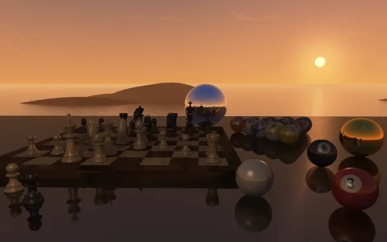
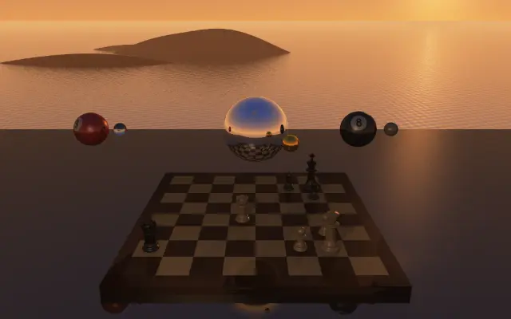
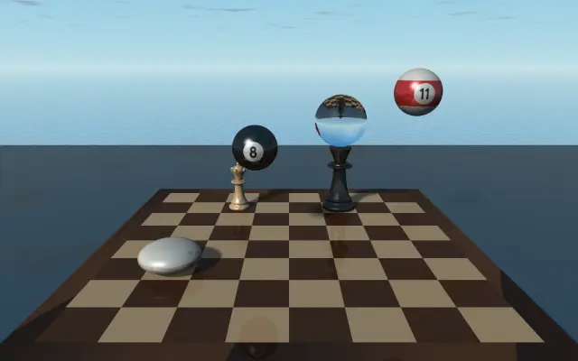
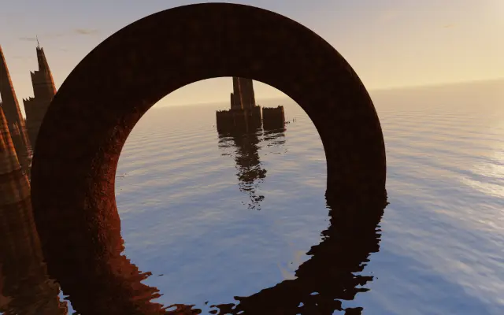
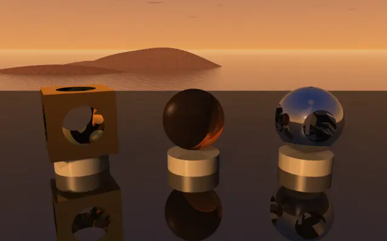
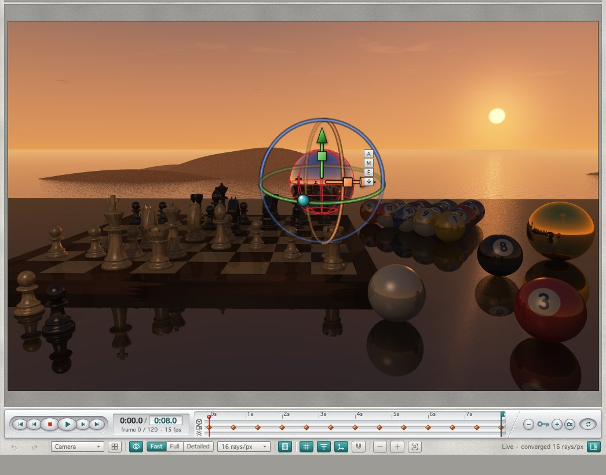
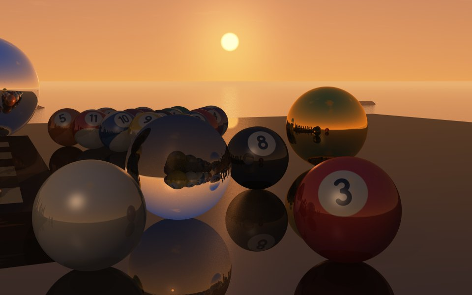
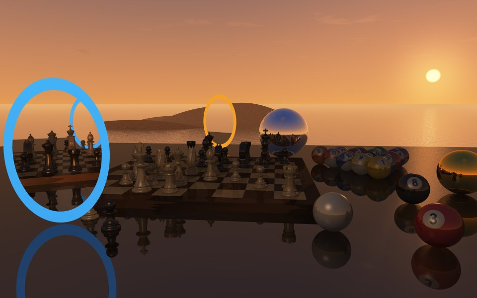

# Hoodoo

**Bryce 2 and Bryce 3D, rebuilt for the browser — with a live ray tracer.**



**Open it: [hoodoo.myfunc.io](https://hoodoo.myfunc.io/)** — nothing to install, works offline once
loaded. The scene above is *Sunset Gambit*, the first animated example
([960×600 WebM](docs/images/demo-gambit.webm)).

Hoodoo brings back MetaTools Bryce 2 (1996): the stone-grey interface, the
wireframe scene window, the camera trackball, the Materials Lab, the Terrain
Editor, Sky & Fog and the picture painted block by block. From Bryce 3D (1997)
it takes the timeline, keys and motion paths. Then it adds what a modern editor
needs: a GPU ray tracer that is live while you edit, glass and mirrors traced
for real, boolean modelling, undo for everything, scene files and share links.
The animated scenes on this page were rendered by Hoodoo itself, frame by
frame, and each one opens from the start window's examples.

## Feature tour

### Animate objects and groups



Switch a scene's animation on (the film chip, or Shift+A), move the red
scrubber and change anything: that is a key. Keys interpolate smoothly and a
path that ends where it began loops without a seam. A group has its own track,
and what it holds keeps its own keys inside it — here each planet is a group
circling the sun while its moon circles the ball. *Example: Billiard Orrery* · [960×600 WebM](docs/images/demo-orrery.webm)

### Animate size



A key holds the size as well as the place and the turn, so things grow,
shrink, squash and stretch on the timeline. *Example: Squash & Stretch* · [960×600 WebM](docs/images/demo-squash.webm)

### Animate the camera



*Animate Camera* (Shift+K) keys the camera, and from then on orbit, pan, walk
and fly become camera moves: position, heading, tilt, bank and lens. The
camera's route shows as a path in the other views. *Example: Hoodoo Run* · [960×600 WebM](docs/images/demo-hoodoo-run.webm)

### Model with booleans



Put objects in a group and mark them Positive, Negative or Intersect
(Attributes › Boolean): negatives cut, intersects clip. The cutters are
ordinary objects, so they move, resize and animate — the cut follows, traced
exactly. *Example: Boolean Carving* · [960×600 WebM](docs/images/demo-carving.webm)

### Move, resize and turn in place



The selection carries handles: arrows move along an axis, cubes stretch along
one (Shift evenly, Alt from the far side), the pale square resizes evenly and
the rings turn (Shift in 15° steps). Hold Z and drag, or scroll, to resize
quickly. With animation on, each drag is a key.

### Materials: glass, mirrors, pool balls



Fourteen procedural textures drive colour, shine, transparency, reflection,
refraction and bump in the Materials Lab. The presets include clear and
coloured glass, Mirror and Gold Mirror, metals, waters and a Chess & Billiards
family: boxwood and ebony pieces, a walnut board and the sixteen numbered
balls. The Object Library builds a Staunton chess set and an 8-ball rack, every
piece an ordinary object.

### Terrains, skies and water

| Surprise Me | Surprise Me |
|---|---|
|  |  |

Terrains and symmetrical lattices with the Terrain Editor (filters, a paint
brush, height-map import and export), infinite water, ground and cloud planes,
and the Bryce sky: sun or moon, clouds, haze, fog, stars and soft shadows.
*Surprise Me* (Alt+Shift+N) builds a whole landscape from one seed.

Sky colours are a toy: pick one Base colour and hover the six Moods (Calm,
Dusk, Pastel, Deep, Split, Mono) to try a whole sky made from it, click to
keep one, drag the Base to turn every hue at once, and drag one colour chip
onto another to copy it. *Haze = Horiz* keeps haze and fog in the horizon's
colour, and *Save sky* keeps your own skies under Sky & Fog ▾ › My skies.

### Portals (preview)



Turn Portals on in View › Preview Features…: *Play › Create Portal Pair* puts a
blue and an orange oval in the scene, and looking into one you see out of the
other — live and in the final render. *Play › Portals & Triggers…* lists every
portal pair and trigger zone to select, rename, link and set up.

### Tutorial Book

Help › Tutorial Book… has step-by-step recipes (sunset over water, a rock on
a hill, a glass ball on checkers, a camera fly-by and more): a picture per step
with a red box on what to click, and the result to expect. *Try it* opens a
fresh scene beside the book. `node tools/make-tutorials.mjs <dev url>` takes
the pictures again from the running app.

### Cloud (preview)

Turn Cloud on in View › Preview Features… to sign in with Google, keep scenes
in the cloud, publish them to a shared Gallery with likes and reports, and
moderate it. It runs on a Cloudflare Worker with D1; see
[docs/cloud.md](docs/cloud.md) to host your own.

### Live ray tracing

| Depth of field | Snapshot compare |
|---|---|
|  |  |

The scene window is ray traced while you work: shadows, reflections and
refraction update as you drag, and the picture refines when you stop. Pick
**Fast** (quickest while moving), **Full** (the finished tracer) or
**Detailed** (glass and mirrors traced twice as deep, frames averaged under a
still camera) on the Render page of the left panel, under Bryce's camera
controls. Render then paints the final picture block by block, as Bryce did,
with depth of field (click to focus, Alt+F). Render View (Opt/Alt+P) shows that
final render in the scene window instead, refining in place while you orbit,
drag and play; the same page trades it for speed and sets how many reflections
mirrors and glass get, up to 16. Snapshots
(B) keep a picture to compare with an A/B slider (Shift+B).

### The editor


Unlimited undo with a clickable history, autosave, `.hoodoo` scene files,
share links that carry the whole scene, tiled high-resolution PNG export,
WebM movies of the timeline, four views and a Director's View, nine camera
bookmarks, a command palette with every action, right-click menus, trackpad
gestures, and an installable offline app.

The tool rail on the left edge opens every panel by name: Controls, Render,
Object, Materials, Terrain, Tutorials, Preview (and Portals or Cloud while
those features are on). A lit button is on view; click it again to put it away.
Each window floats over the scene or docks in the left panel, and the dock
widens when a page needs the room.

## Keyboard and mouse

| Do | How |
|---|---|
| Orbit, pan, dolly | Drag empty space in the scene window (or right-drag anywhere, or drag the trackball); two-finger trackpad gestures; the wheel dollies |
| Walk and fly | W A S D, R / C up and down, Shift faster; right-drag + keys to look around |
| Select, move | Click a wireframe; drag it, or its handles; Shift+drag on empty space draws a selection box |
| Resize quickly | Hold Z and drag, or scroll |
| Move, rotate, size by keys | G moves the selection with the mouse; then R rotates, S sizes, G moves again |
| Lock an axis | X, Y or Z (the same key again unlocks); Shift+X/Y/Z: the plane without that axis; X/Y/Z while dragging locks the drag too |
| Exact amount, snapping | Type a number: metres, degrees or a factor (`-` flips the sign); hold Ctrl/Cmd to snap: grid step, 15°, 0.1 |
| Apply / cancel | Enter or click / Esc or right-click: everything goes back |
| Frame selection / scene | F / Shift+F |
| Animation on / off | Shift+A |
| Play / pause | Shift+Space |
| Add key / animate camera | K / Shift+K |
| Previous / next frame | `,` / `.` |
| Previous / next key | Shift+`,` / Shift+`.` |
| Pick keys on the timeline | Click, Shift/Cmd-click or drag a box; double-click a row picks all its keys |
| Move, copy, delete picked keys | Drag them; ← / → a frame (Shift: 10); Alt+drag copies; Del deletes |
| Render / stop | Ctrl/Cmd+R / Ctrl/Cmd+`.` |
| Live preview on / off | P |
| Render View on / off | Opt/Alt+P |
| Materials Lab / Terrain Editor | M / E |
| Object Library | Alt+O |
| Undo / redo | Ctrl/Cmd+Z / Ctrl/Cmd+Shift+Z |
| Command palette | Ctrl/Cmd+P or Ctrl/Cmd+K |
| All shortcuts | ? |

## Run it locally

Requires Node.js 20 or newer.

```bash
npm ci
npm run dev        # http://localhost:5640
```

Any browser with WebGL 2 and float render targets works: current Chrome,
Edge, Firefox and Safari. Movie export needs WebCodecs with VP8 or VP9 (Chrome,
Edge, Firefox). On the first visit the ray tracer is compiled for the local
GPU — a fraction of a second on macOS, several seconds with Direct3D on
Windows; the editor can be used meanwhile, and later visits reuse the program.

`npm run build` makes static files with relative paths, to host at a root or a
sub-path. The public instance runs on Cloudflare Workers as static assets
(`npm run deploy`, see `wrangler.jsonc`); `deploy/nginx.conf` is a sample for
nginx, and [SECURITY.md](SECURITY.md) explains the response headers.

## How it is built

TypeScript, Vite and WebGL 2, with no runtime dependencies. The code is split
into layers that only import downwards, enforced by ESLint:

```
core → model → assets → world → render / io → input → ui → app
```

| Layer | Contents |
|---|---|
| `core` | vectors, matrices, colour, events, logging, seeded random numbers, key names |
| `model` | scene types and enums, ids, the material factory |
| `assets` | presets as data: materials, skies, objects, terrain recipes, chess and billiards |
| `world` | the immutable scene and undo, animation keys and interpolation, terrains, camera math, scene files, the landscape generator, the example scenes |
| `render` | the GPU ray tracer, live and final renderers, thumbnails, tiled export, wireframes |
| `io` | project files, autosave, share links, image export, the WebM encoder |
| `input` | actions, key bindings, the scene-window pointer handling |
| `ui` | the UI kit, the Bryce chrome, labs and panels |
| `app` | composition root and commands |

A `.hoodoo` file is JSON (`format: "hoodoo-scene"`); a share link holds the
same JSON, deflated, in the URL fragment, so it never reaches a server. How the
renderer works is in [docs/rendering.md](docs/rendering.md).

## Contributing

Tests, lint, the code rules and the headless tools — including the ones that
render the start window's thumbnails and the clips on this page — are in
[CONTRIBUTING.md](CONTRIBUTING.md).

## Credits

Bryce is a trademark of DAZ 3D. Bryce 2 was created by Kai Krause and Eric
Wenger at MetaTools (1996). Hoodoo is an independent tribute, not affiliated
with or endorsed by DAZ 3D or the original authors, and contains none of their
code or assets. The name comes from the rock spires of Bryce Canyon.

## License

[MIT](LICENSE)
